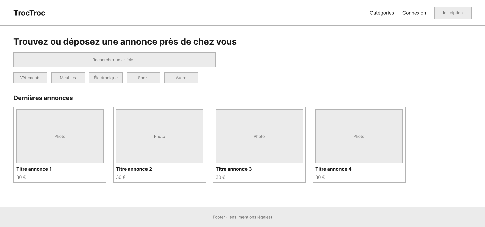
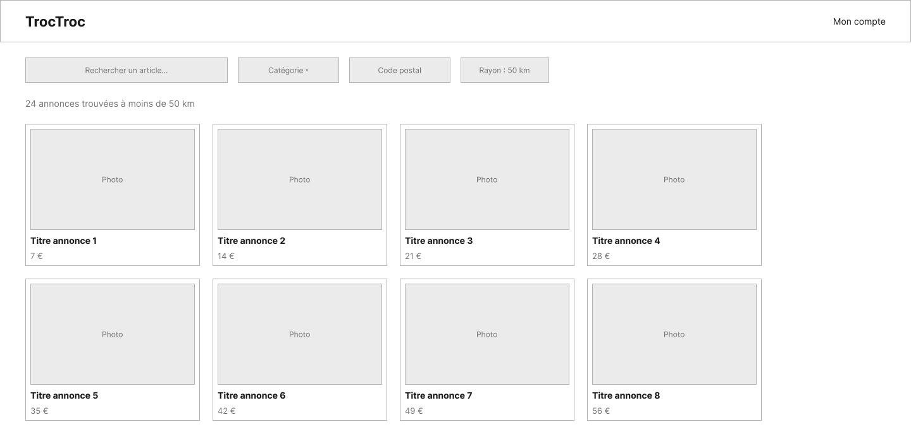
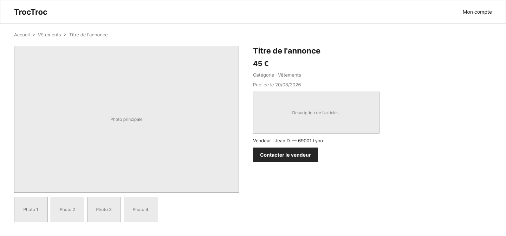
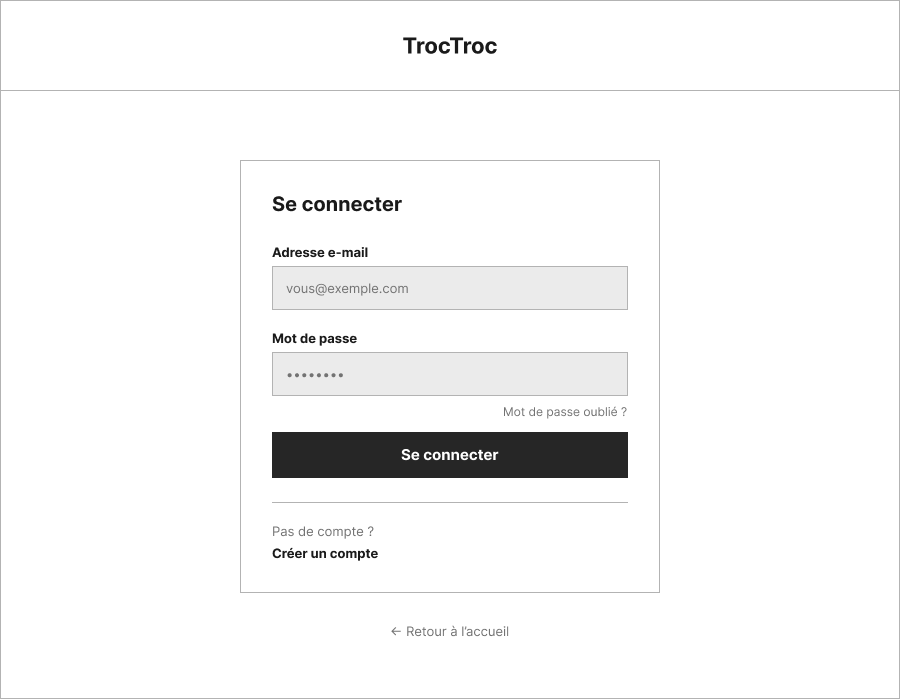
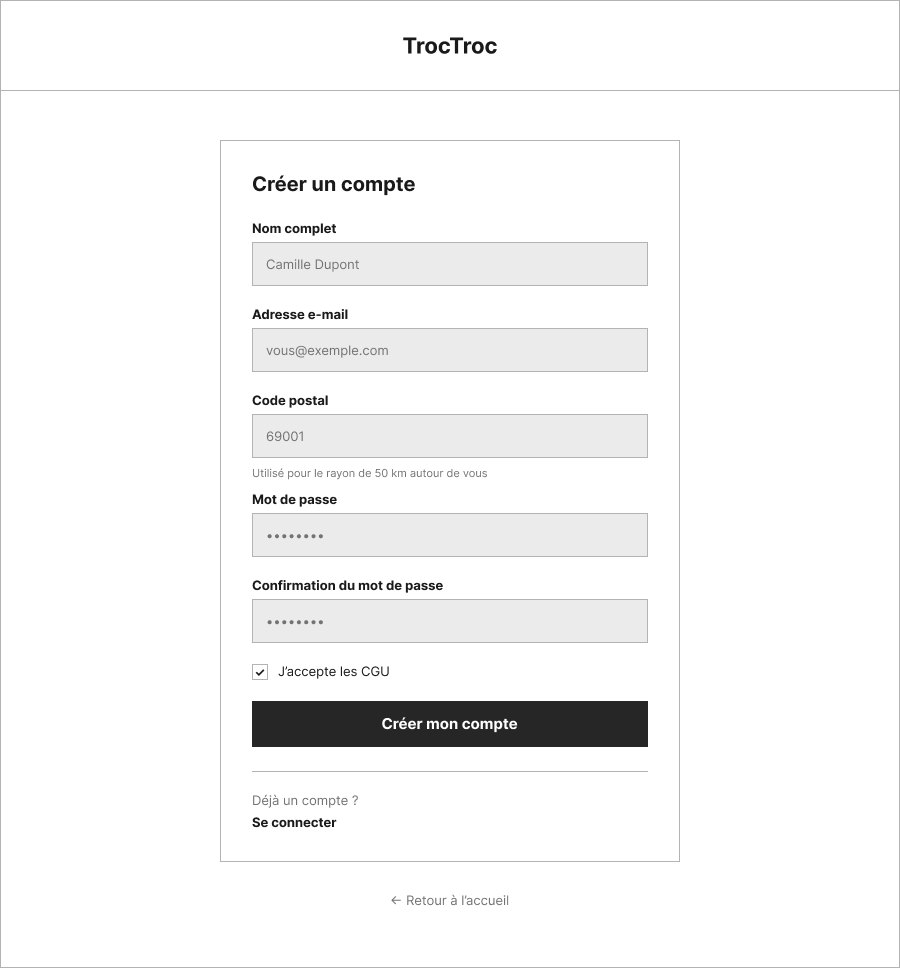
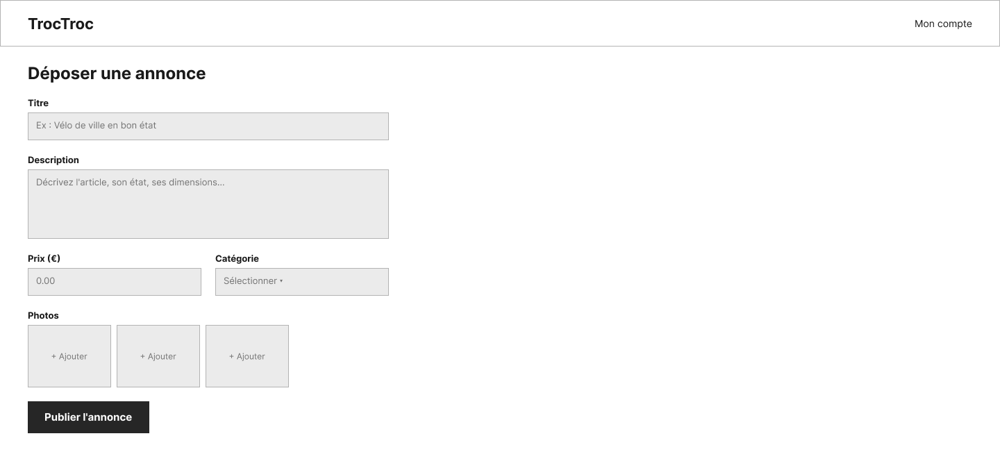
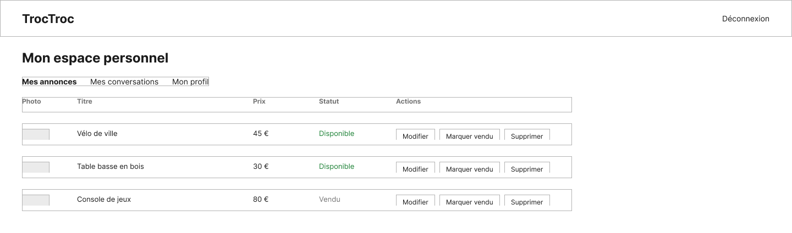
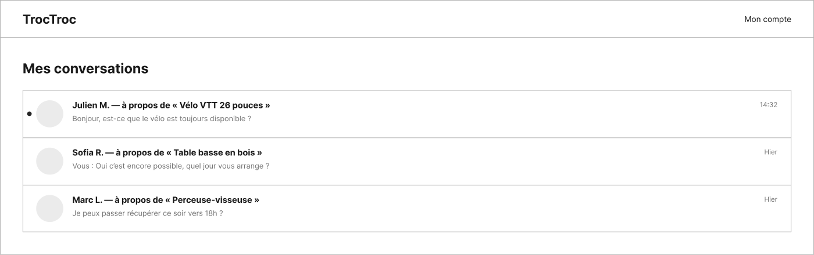

# TrocTroc — Wireframes

Wireframes basse-fidélité (structure uniquement, pas de charte graphique) des écrans de TrocTroc. Les repères `US##` renvoient aux user stories détaillées dans le [cahier des charges](troctroc-cahier-des-charges.md).

9 écrans couverts, regroupés par parcours : découverte (visiteur), authentification et dépôt d'annonce, espace personnel et messagerie interne (utilisateur connecté).

8 de ces écrans ont été maquettés sur Figma (voir [le fichier Figma](https://www.figma.com/design/iIAIDpAAOYb3ngBN7xPtw7)) ; les captures sont versionnées dans [`wireframes/`](wireframes/) et intégrées ci-dessous. Le fil de conversation n'a pour l'instant qu'une description texte, sa maquette Figma est en attente.

---

## 1. Découverte

### 1.1 Accueil — US01



```
┌──────────────────────────────────────────────────────────────────┐
│ [TT] TrocTroc     [ Rechercher un article... ]        Catégories │
│                                            Connexion   S'inscrire │
├──────────────────────────────────────────────────────────────────┤
│            Achetez, vendez et échangez près de chez vous          │
│   [ Ex. vélo, canapé, console... ]  [Code postal]  [Rechercher]   │
├──────────────────────────────────────────────────────────────────┤
│ Catégories                                                        │
│ [Mobilier] [Électroménager] [Vêtements] [Sport & Loisirs]         │
│ [Multimédia] [Enfants & Bébé] [Bricolage & Jardin] [Véhicules]    │
├──────────────────────────────────────────────────────────────────┤
│ Dernières annonces                                                │
│ ┌────────┐ ┌────────┐ ┌────────┐ ┌────────┐                      │
│ │ photo  │ │ photo  │ │ photo  │ │ photo  │   (8 annonces,       │
│ │ Vélo   │ │ Canapé │ │Console │ │ Table  │    2 lignes x 4)     │
│ │ 45 €   │ │ 120 €  │ │ 60 €   │ │ 30 €   │                      │
│ │ 3 km   │ │ 6 km   │ │ 5 km   │ │ 9 km   │                      │
│ └────────┘ └────────┘ └────────┘ └────────┘                      │
├──────────────────────────────────────────────────────────────────┤
│ © TrocTroc                              À propos · CGU · Contact │
└──────────────────────────────────────────────────────────────────┘
```

- En-tête (variante visiteur) : logo, barre de recherche, lien Catégories, boutons Connexion / S'inscrire.
- Bloc d'accroche avec recherche par mots-clés + code postal.
- Grille de catégories (8 tuiles).
- Grille des 8 dernières annonces : photo, titre, prix, distance.

### 1.2 Liste des annonces — US07, US08, US09, US10



```
┌──────────────────────────────────────────────────────────────────┐
│ [TT] TrocTroc     [ vélo ]                Connexion   S'inscrire │
├──────────────────────────────────────────────────────────────────┤
│ Accueil / Résultats pour « vélo »                                 │
├───────────────────┬────────────────────────────────────────────┤
│ Filtres            │ 24 annonces trouvées      Trier par : ▾    │
│ ┌ Catégorie        │ ┌────────┐ ┌────────┐ ┌────────┐           │
│ │ [x] Sport&Loisirs │ │ photo  │ │ photo  │ │ photo  │           │
│ │ [ ] Vélos&Trott.  │ │ Vélo   │ │ VENDU  │ │ Vélo   │           │
│ │ [ ] Mobilier      │ │ VTT    │ │ Vélo   │ │ élec.  │           │
│ ├ Code postal       │ │ 45 €   │ │ ville  │ │ 380 €  │           │
│ │ [ 69003 ]         │ └────────┘ └────────┘ └────────┘           │
│ ├ Rayon             │        ... (3 colonnes x 3 lignes)         │
│ │ [====o——] 50 km   │                                            │
│ ├ Prix               │                                            │
│ │ [Min] [Max]        │           ‹  1  2  3  …  8  ›              │
│ │ [Appliquer]         │                                          │
│ └────────────────────┴────────────────────────────────────────┘ │
└──────────────────────────────────────────────────────────────────┘
```

- Fil d'Ariane + rappel de la recherche en cours.
- Panneau de filtres à gauche : catégories (cases à cocher), code postal, curseur de rayon (5 à 50 km), fourchette de prix.
- Grille de résultats à droite (3 colonnes) : une carte porte le badge « Vendu » pour illustrer cet état.
- Pagination en bas de liste.

### 1.3 Détail d'une annonce — US11, US12



```
┌──────────────────────────────────────────────────────────────────┐
│ [TT] TrocTroc     [ Rechercher... ]        Connexion   S'inscrire│
├──────────────────────────────────────────────────────────────────┤
│ Accueil / Sport & Loisirs / Vélo VTT 26 pouces                    │
├───────────────────────────────┬──────────────────────────────────┤
│ ┌─────────────────────────┐   │ Sport & Loisirs                  │
│ │                         │   │ Vélo VTT 26 pouces                │
│ │      photo principale   │   │ 45 €                              │
│ │                         │   │ Lyon 69003 · à 3 km               │
│ └─────────────────────────┘   │ Publiée le 12 août 2026           │
│ [th1][th2][th3][th4]          │ ┌───────────────────────────┐     │
│                                 │ │ (avatar) Camille D.        │     │
│ Description                    │ │ Membre depuis 2024 · 8 ann. │     │
│ Vélo VTT 26 pouces, bon état…  │ └───────────────────────────┘     │
│                                 │ [   Contacter le vendeur    ]    │
├───────────────────────────────┴──────────────────────────────────┤
│ Annonces similaires : [photo] [photo] [photo] [photo]             │
└──────────────────────────────────────────────────────────────────┘
```

- Colonne gauche : galerie (photo principale + 4 vignettes), description.
- Colonne droite : catégorie, titre, prix, localisation + distance, date de publication, encart vendeur, bouton principal « Contacter le vendeur ».
- Bas de page : annonces similaires.

---

## 2. Authentification & dépôt d'annonce

### 2.1 Connexion — US03



```
┌───────────────────────────┐
│        [TT] TrocTroc       │
│                             │
│   ┌─────────────────────┐   │
│   │ Se connecter        │   │
│   │ [ Adresse e-mail ]  │   │
│   │ [ Mot de passe   ]  │   │
│   │       Mot de passe  │   │
│   │           oublié ?  │   │
│   │ [  Se connecter  ]  │   │
│   │ ─────────────────── │   │
│   │ Pas de compte ?     │   │
│   │ Créer un compte  │   │
│   └─────────────────────┘   │
│    ← Retour à l'accueil    │
└───────────────────────────┘
```

- En-tête minimal (logo centré).
- Carte centrée : e-mail, mot de passe, lien mot de passe oublié, bouton principal, lien vers l'inscription.

### 2.2 Inscription — US02



```
┌─────────────────────────────┐
│        [TT] TrocTroc        │
│   ┌───────────────────────┐ │
│   │ Créer un compte       │ │
│   │ [ Nom complet     ]   │ │
│   │ [ Adresse e-mail  ]   │ │
│   │ [ Code postal     ]   │ │
│   │  (utilisé pour le     │ |
│   │   rayon de 50 km)     │ │
│   │ [ Mot de passe    ]   │ │
│   │ [ Confirmation    ]   │ │
│   │ [x] J'accepte les CGU │ │
│   │ [ Créer mon compte ]  │ │
│   │ ───────────────────   │ │
│   │ Déjà un compte ?      │ │
│   │ Se connecter          │ │
│   └───────────────────────┘ │ 
└─────────────────────────────┘
```

- Mêmes principes que la connexion, avec en plus nom, code postal (nécessaire au filtrage géographique 50 km) et confirmation du mot de passe.

### 2.3 Dépôt d'une annonce — US05, US06



```
┌──────────────────────────────────────────────────────────────────┐
│ [TT] TrocTroc   [ Rechercher... ]   [+ Déposer] (msg) (Camille)  │
├──────────────────────────────────────────────────────────────────┤
│ Déposer une annonce                                              │
│ ┌────────────────────────────────────────────────────────────┐   │
│ │ Titre de l'annonce  [                                    ] │   │
│ │ Description          [                                    ]│   │
│ │                       [                                   ]│   │
│ │ Prix [       €]        Catégorie [ Sport & Loisirs      ▾]  │  │
│ │ Photos                                                        ││
│ │  ┌──────────────────────────────────────────────────────┐   │  │
│ │  │      Glissez vos photos ici ou cliquez pour parcourir  │   ││
│ │  └──────────────────────────────────────────────────────┘   │  │
│ │  [photo x] [photo x] [ + ]                                    ││
│ │                                        [Annuler] [Publier]   │ │
│ └────────────────────────────────────────────────────────────┘   │
└──────────────────────────────────────────────────────────────────┘
```

- En-tête (variante connecté) : recherche, bouton « Déposer une annonce » (actif), icône messagerie, avatar utilisateur.
- Formulaire : titre, description, prix, catégorie, zone de dépôt de photos avec vignettes ajoutées/supprimables.
- Actions : Annuler / Publier l'annonce.

---

## 3. Espace personnel & messagerie interne

### 3.1 Espace personnel — US18, US19, US20, US21



```
┌────────────────────────────────────────────────────────────────────┐
│ [TT] TrocTroc   [ Rechercher... ]   [+ Déposer] (msg) (Camille)    │
├───────────────┬────────────────────────────────────────────────────┤
│ (avatar)       │ Mes annonces | Mes conversations | Mon profil     │
│ Camille D.     │ ────────────                                      │
│ Lyon · 69003   │ Annonce         Prix  Statut      Publiée  Actions│
│ Modifier profil│ [img] Vélo VTT  45 €  Disponible  12 août  ✎ ✓ 🗑  │
│                │ [img] Table     30 €  Disponible  5 août   ✎ ✓ 🗑  │
│                │ [img] Chaise    40 €  Vendu       28 juil. ✎   🗑  │
│                │ [img] Perceuse  35 €  Disponible  20 juil. ✎ ✓ 🗑  │
└───────────────┴────────────────────────────────────────────────────┘
```

- Colonne gauche : résumé du profil (avatar, nom, localisation, lien de modification).
- Onglets : Mes annonces (actif) / Mes conversations / Mon profil.
- Tableau des annonces : photo, titre, prix, statut (Disponible / Vendu), date, actions (✎ modifier, ✓ marquer vendu, 🗑 supprimer).

### 3.2 Mes conversations — US15



```
┌──────────────────────────────────────────────────────────────────┐
│ [TT] TrocTroc   [ Rechercher... ]   [+ Déposer] (msg) (Camille)  │
├──────────────────────────────────────────────────────────────────┤
│ Mes conversations                                                │
│ ┌────────────────────────────────────────────────────────────┐   │
│ │ (◔) Julien M. — à propos de « Vélo VTT 26 pouces »   14:32 │   │
│ │     Bonjour, est-ce que le vélo est toujours disponible ?  │   │
│ ├────────────────────────────────────────────────────────────┤   │
│ │ (◔) Sofia R. — à propos de « Table basse en bois »    Hier │   │
│ │     Vous : Oui c'est encore possible, quel jour vous arrange?│ │
│ ├────────────────────────────────────────────────────────────┤   │
│ │ (◔) Marc L. — à propos de « Perceuse-visseuse »       Hier │  │
│ │     Je peux passer récupérer ce soir vers 18h ?            │   │
│ └────────────────────────────────────────────────────────────┘   |
└──────────────────────────────────────────────────────────────────┘
```

- Liste des conversations : avatar, interlocuteur, annonce concernée, dernier message, horodatage, pastille de message non lu (●).

### 3.3 Fil de conversation — US13, US14, US16, US17

*Maquette Figma en attente (limite d'appels API atteinte) — description texte ci-dessous en attendant.*

```
┌──────────────────────────────────────────────────────────────────┐
│ [TT] TrocTroc   [ Rechercher... ]   [+ Déposer] (msg) (Camille)  │
├───────────────┬──────────────────────────────────────────────────┤
│ Conversations  │ [img] Vélo VTT 26 pouces · 45 € · avec Julien M.│
│ ▸ Julien M.    │                              [ Voir l'annonce ] │
│   Sofia R.     ├─────────────────────────────────────────────────┤
│   Marc L.      │ (Julien) Bonjour, le vélo est toujours dispo ?  │
│   Nadia B.     │                    (Vous) Oui, disponible ce    │
│                │                    week-end à Lyon 3e.          │
│                │ (Julien) Parfait, samedi matin ça marche ?      │
│                │                    (Vous) Avec plaisir, je vous │
│                │                    envoie l'adresse samedi.     │
│                ├─────────────────────────────────────────────────┤
│                │ [ Écrire un message...              ] [Envoyer] │
└───────────────┴──────────────────────────────────────────────────┘
```

- Colonne gauche : liste compacte des conversations, conversation active surlignée.
- Colonne droite : rappel de l'annonce concernée en en-tête (avec lien « Voir l'annonce »), fil de messages en bulles alternées (interlocuteur à gauche, soi-même à droite), champ de saisie + bouton Envoyer.

---

## Éléments transverses

- **En-têtes réutilisés** : variante visiteur (recherche + Connexion/S'inscrire) sur Accueil, Liste, Détail ; variante connectée (recherche + Déposer une annonce + icône messagerie + avatar) sur Dépôt, Espace personnel, Messagerie ; en-tête minimal (logo seul) sur Connexion/Inscription.
- **Rôle contextuel** : un même compte utilisateur agit comme acheteur ou vendeur selon l'annonce (voir [MCD](troctroc-user-stories-mcd.md)) — pas de distinction d'écran entre les deux rôles.
- **États à illustrer** : annonce « Vendue » (liste des annonces, espace personnel), message non lu (messagerie).

---

Voir aussi : [Cahier des charges](troctroc-cahier-des-charges.md) · [User stories](troctroc-user-stories.md) · [MCD](troctroc-user-stories-mcd.md) · [MLD](troctroc-mld.md) · [Dictionnaire des données](troctroc-dictionnaire-donnees.md)
